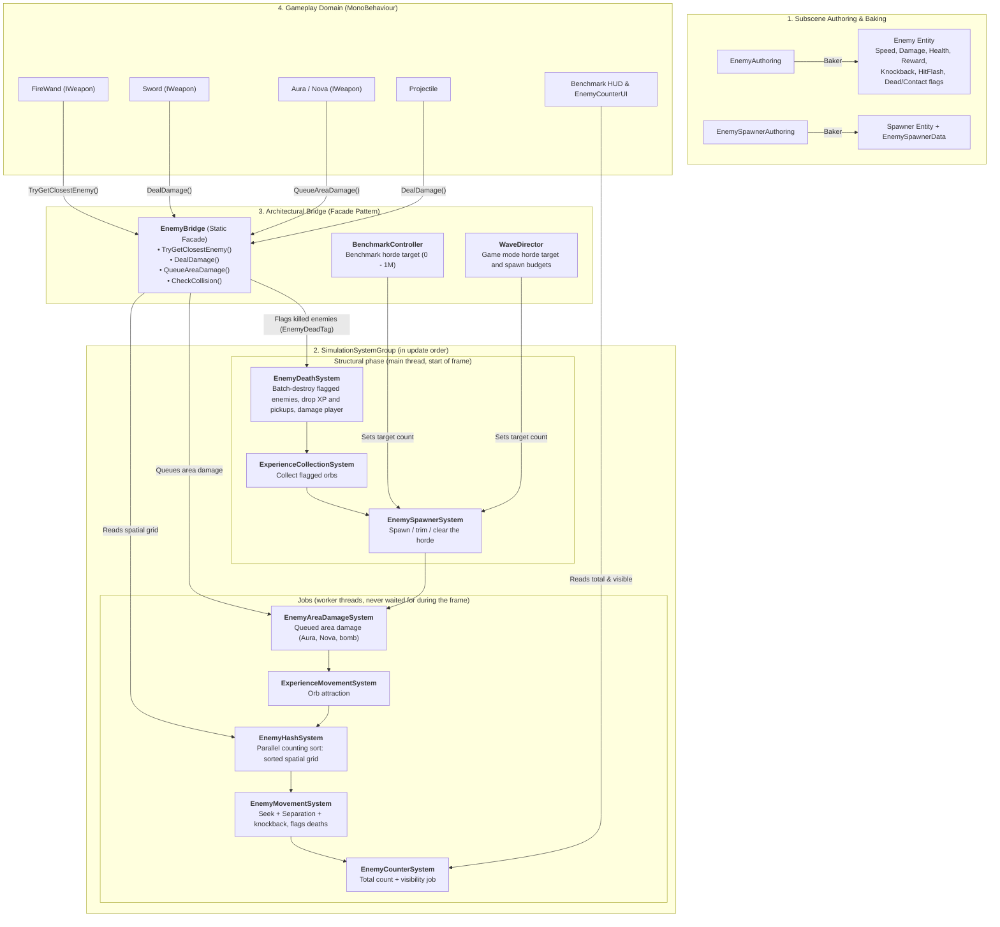
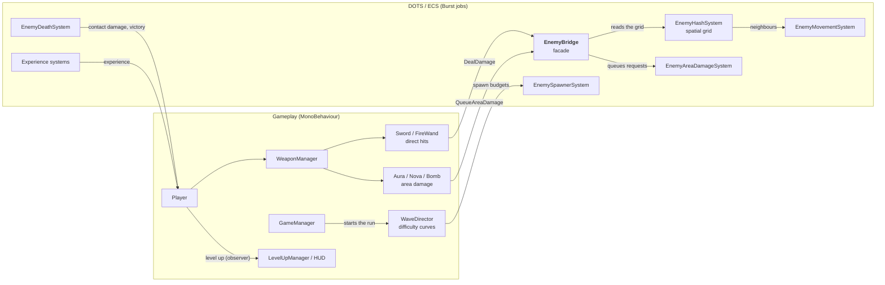

# Roguelike Benchmark: Classic OOP vs. Unity DOTS/ECS

[](https://unity.com/)
[](https://unity.com/dots)
[](https://docs.unity3d.com/Packages/com.unity.burst@latest)
[](#phase-2-dotsecs-hybrid-architecture)
[](https://elven21.itch.io/performancemaxxing)

A performance benchmark and portfolio project developed in **Unity 6**. The same Survivor-like game is implemented twice, once with **classic Object-Oriented Programming (MonoBehaviour)** and once with the **Data-Oriented Technology Stack (DOTS / ECS)**, then profiled under identical conditions to measure where each architecture reaches its limits, and why.

> ### DOTS/ECS handles **30× more enemies** at a playable framerate (8,000 → 250,000), and simulates them **91× faster** (45.59 ms → 0.50 ms at 10,000 enemies).

The DOTS version is also a **playable game**, **PerformanceMaxxing**: a 5-minute survival run against a horde of up to 20,000 enemies, ending with a final boss (see [Game Mode](#game-mode)). **[Download it on itch.io](https://elven21.itch.io/performancemaxxing)** (Windows).


<a id="key-results"></a>
## Key Results

| | Classic OOP | DOTS / ECS |
|:---|:---:|:---:|
| **Simulation time @ 10,000 enemies** | 45.59 ms | **0.50 ms** (×91) |
| **Max playable horde (≥ 30 FPS)** | ~8,000 | **~250,000** (~40 FPS) |
| **Simulation cost per enemy** | ~4.6 µs | **~0.04 µs** (~110× less) |

> Simulating **1,000,000** enemies with DOTS (40.57 ms) takes less time than simulating **10,000** with OOP (45.59 ms).

A third phase then uses the profiler's Timeline to optimize the DOTS pipeline itself. It did not raise the framerate, and showed that the frame is now bound by the render thread rather than the simulation. See [Phase 3](#phase-3-profiling-driven-optimization).

<picture>
  <source media="(prefers-color-scheme: dark)" srcset="Documentation/images/benchmark_chart_dark.png">
  
</picture>

Full methodology and per-step analysis: [Performance Comparison](#performance-comparison-hardware-analysis) · [Complete report (PDF)](Documentation/PerformanceMaxxing_Performance_Report.pdf)

---

## Table of Contents
1. [Project Overview](#project-overview)
2. [Phase 1: Classic OOP Architecture & Profiling](#phase-1-classic-oop-architecture-profiling)
3. [Phase 2: DOTS/ECS & Hybrid Architecture](#phase-2-dotsecs-hybrid-architecture)
4. [Performance Comparison & Hardware Analysis](#performance-comparison-hardware-analysis)
5. [Phase 3: Profiling-Driven Optimization](#phase-3-profiling-driven-optimization)
6. [Game Mode: A Playable Survivor-like on Top of ECS](#game-mode)
7. [Challenges & Lessons Learned](#challenges-lessons-learned)
8. [Next Steps](#next-steps)
9. [Getting Started](#getting-started)
10. [Controls & In-Game Benchmark HUD](#controls-in-game-benchmark-hud)
11. [Code Conventions](#code-conventions)
12. [Tech Stack](#tech-stack)

---

<a id="project-overview"></a>
## Project Overview

In Survivor-like games, thousands of enemies chase the player at the same time. Updating and rendering that many agents every frame is one of the most demanding workloads for a game engine.

This project implements the same game mechanics twice:
1. **OOP implementation**: standard Unity `MonoBehaviour` development, optimized with object pooling, a 2D spatial hash grid and time-sliced Boids steering.
2. **DOTS/ECS implementation**: the enemy simulation rebuilt with **Entities**, the **C# Job System** and the **Burst Compiler**, rendered through **Entities Graphics**.

An **in-game benchmark controller** changes the horde size at runtime, from 1,000 up to 1,000,000 enemies, without recompiling.

---

<a id="phase-1-classic-oop-architecture-profiling"></a>
## Phase 1: Classic OOP Architecture & Profiling

### Architecture


1. **Observer Pattern**: `Player` acts as `ISubject` and notifies the UI (`ExperienceBar`, `LevelUpManager`) without direct dependencies.
2. **Strategy Pattern for Weapons**: `WeaponManager` updates every weapon through the `IWeapon` interface. Weapon stats are data-driven `ScriptableObject` assets (`WeaponUpgradeData`), so new weapons can be added from the Inspector.
3. **Spatial Hash Grid**: reduces neighbor search from $\mathcal{O}(n^2)$ to $\mathcal{O}(n)$ by mapping enemies into 2D cells: each query only scans the neighboring cells instead of every enemy.
4. **Object Pooling**: enemies, projectiles, damage texts and experience gems are pre-allocated, keeping allocations on the critical path to **0 – 1 KB per frame**.
5. **Boids-Inspired Horde Steering**: each enemy blends a *Seek* vector (towards the player) with a smoothed, time-sliced *Separation* vector (`Vector3.Lerp`) to avoid overlapping without visible teleportation.

### Profiling & Identifying the Bottleneck

The Unity Profiler points to `EnemyPool.Update() -> Enemy.Tick()` as the main cost of the frame:


Custom profiler samples inside `Enemy.Tick()` show that the steering calculations (`1_Enemy_Maths_Boids`) account for more than **75% of the frame CPU time**:


Even with the spatial grid, neighbor caching and separation updates spread over 4 frames, the horde steering runs on a single thread and its cost grows with every enemy added.

<a id="oop-benchmark-results"></a>
### OOP Benchmark Results

| Enemy Count | `EnemyPool.Update()` (ms) | Observed FPS | Playability |
|:---:|:---:|:---:|:---|
| **2,000** | 4.21 ms | > 144 FPS | Smooth and stable |
| **4,000** | 8.94 ms | ~120 FPS | Minor drops below the monitor refresh rate |
| **6,000** | 19.64 ms | ~60 FPS | Playable |
| **8,000** | 35.40 ms | ~30 FPS | Degraded, practical limit |
| **10,000** | **45.59 ms** | **< 20 FPS** | **Unplayable** |

> **OOP Conclusion**: the playable limit of the OOP implementation is **~8,000 enemies** (~30 FPS). The root cause is not the algorithm itself but the memory layout: each `GameObject` and `MonoBehaviour` is a separate object scattered across the heap, so the CPU spends much of its time waiting for data (cache misses), all on a single thread.

---

<a id="phase-2-dotsecs-hybrid-architecture"></a>
## Phase 2: DOTS/ECS & Hybrid Architecture

Only the massive part of the game (enemies and experience orbs) moved to ECS. The player, the weapons and the UI remain MonoBehaviours: converting objects that exist once brings no measurable gain and makes gameplay code harder to iterate on.

The architecture below is the current one, including the changes made in [Phase 3](#phase-3-profiling-driven-optimization).

### Data-Oriented Pipeline & Hybrid Bridge



### Data-Oriented Design (DOD) Principles

```
Classic OOP (scattered heap objects):
[ Enemy 1: Transform | Health | Speed | Sprite ] -> pointer -> [ Enemy 2 ] -> ...   (cache misses)

DOTS / ECS (Structure of Arrays in 16 KB archetype chunks):
Chunk: [ Transform | Transform | Transform ... ]   <-- read linearly, prefetched by the CPU
       [ Speed     | Speed     | Speed     ... ]   <-- processed by Burst jobs on all cores
```

- **Archetype Chunks**: entities with the same set of components are packed contiguously in 16 KB chunks.
- **Cache Locality**: systems iterate over linear arrays, which the CPU prefetches efficiently.
- **Burst + Job System**: jobs are compiled to optimized native code (LLVM) and spread across all worker threads.

### Core Systems Overview

1. [`EnemyDeathSystem`](Assets/Scripts/Enemy/EnemyDeathSystem.cs): at the start of the frame, destroys every enemy flagged with `EnemyDeadTag` in one batch, drops their experience orbs (and, rarely, a pickup), updates the score and applies the damage of the enemies that touched the player. Gathering the structural changes here means no enemy job ever has to be waited for during its frame.
2. [`EnemySpawnerSystem`](Assets/Scripts/Enemy/EnemySpawnerSystem.cs): instantiates enemies along the camera edges until the target count is reached, and trims or clears the horde when the target drops. In Benchmark mode it fills the horde as fast as possible (up to 25,000 per frame); in Game mode it follows the spawn budgets of the `WaveDirector`, including elites, runner packs and the final boss.
3. [`EnemyAreaDamageSystem`](Assets/Scripts/Enemy/EnemyAreaDamageSystem.cs): applies the area damage queued by the weapons (rings and discs) in a parallel Burst job over all enemies: health, hit flash, knockback and death flag.
4. [`EnemyHashSystem`](Assets/Scripts/Enemy/EnemyHashSystem.cs): builds a sorted spatial grid with a parallel counting sort (keys and counting, prefix sum, scatter), so the enemies of a cell are stored contiguously in memory.
5. [`EnemyMovementSystem`](Assets/Scripts/Enemy/EnemyMovementSystem.cs): parallel Burst `IJobEntity` combining *Seek* and *Separation*. Separation is time-sliced over 4 frames, limited to 4 neighbors, and visits cells in a spiral order to avoid directional bias. The same job applies the knockback and fades the hit flash. Enemies touching the player are only flagged (`EnemyDeadTag` + `EnemyContactTag`), so the job never writes into a command buffer.
6. [`EnemyCounterSystem`](Assets/Scripts/UI/EnemyCounterSystem.cs): reads the total count from chunk metadata and counts on-screen enemies with a Burst job, for the HUD.
7. [`ExperienceMovementSystem` / `ExperienceCollectionSystem`](Assets/Scripts/Experience/ExperienceMovementSystem.cs): attract experience orbs towards the player, and collect them at the start of the next frame (through the `BeginSimulation` command buffer).

### Decoupling with the EnemyBridge Facade

[`EnemyBridge`](Assets/Scripts/Enemy/EnemyBridge.cs) keeps the gameplay code independent from ECS:
- **No leaky abstractions**: weapons and projectiles never import `Unity.Entities` nor access the ECS world directly.
- **Encapsulated grid**: the cell size is `internal` to the simulation; weapons simply call `EnemyBridge.TryGetClosestEnemy(origin, range, out target)`.
- **Single-pass damage**: `DealDamage` damages the enemies in range, flags the ones it kills and returns the hit count in one grid traversal, instead of a collision check followed by a damage query.
- **Area damage off the main thread**: `QueueAreaDamage` only records a request; `EnemyAreaDamageSystem` applies it to every enemy in a parallel job, so an Aura or a bomb hitting thousands of enemies costs almost nothing on the main thread.
- **Safe main-thread access**: the grid jobs are not waited for during their frame, so the bridge completes their handle before reading the grid (the jobs are long finished by then, so this costs nothing).

---

<a id="performance-comparison-hardware-analysis"></a>
## Performance Comparison & Hardware Analysis

### Test Machine

| Component | Specification |
|:---|:---|
| **Laptop** | HP Victus 15-fa0xxx |
| **CPU** | Intel Core i5-12450H (8 cores: 4 Performance + 4 Efficient, 12 threads) |
| **GPU** | NVIDIA GeForce RTX 3050 Laptop GPU (4 GB) |
| **RAM** | 16 GB DDR4 3200 MT/s |
| **OS** | Windows 11 (64-bit) |

### Methodology

- **Same conditions**: both implementations were measured on the machine above, in a development build connected to the Unity Profiler (no Editor overhead).
- **Simulation metric**: OOP measures `EnemyPool.Update()`; DOTS measures `SimulationSystemGroup` on the main thread. Since DOTS jobs run on worker threads, this includes scheduling the jobs *and waiting for them*, plus the XP orbs and the spawner: a slightly pessimistic but fair equivalent.
- **Frame metric**: `PlayerLoop`, the whole CPU frame (simulation, rendering preparation, UI).
- **Scenario**: the player stands still with a single weapon active, so the horde size stays stable during the capture.
- **Protocol**: profiler values come from a representative frame once the horde size is stable. FPS values are read from the in-game FPS counter.
- **Scope**: these measurements were taken before the [Game Mode](#game-mode) was added. The Benchmark mode keeps the same scenario (no waves, elites or pickups), but enemies now also carry health, knockback and hit-flash data, so the movement job does slightly more work than when it was measured.

### DOTS / ECS Results

| Enemies | Simulation (ms) | Time per Enemy (µs) | Full CPU Frame (ms) | In-game FPS |
|:---:|:---:|:---:|:---:|:---:|
| 2,000 | 0.24 | 0.120 | 2.73 | — |
| 4,000 | 0.29 | 0.073 | 2.62 | — |
| 6,000 | 0.31 | 0.052 | 2.63 | — |
| 8,000 | 0.41 | 0.051 | 3.04 | — |
| 10,000 | 0.50 | 0.050 | 2.78 | ~300 |
| 50,000 | 1.92 | 0.038 | 6.83 | ~160 |
| 100,000 | 4.14 | 0.041 | 9.88 | ~100 |
| **250,000** | **9.08** | **0.036** | **22.93** | **~40** |
| 500,000 | 19.02 | 0.038 | 43.00 | ~20 |
| 1,000,000 | 40.57 | 0.041 | 88.62 | ~10 |

Up to 10,000 enemies the cost is dominated by the fixed overhead of the ECS pipeline (system updates, job scheduling, synchronization). From 50,000 onwards, the simulation scales linearly at **~0.04 µs per enemy**.

<details>
<summary><b>Profiler captures (10k · 250k · 1M)</b></summary>

**10,000 enemies**: `SimulationSystemGroup` 0.50 ms, `PlayerLoop` 2.78 ms


**250,000 enemies**: `SimulationSystemGroup` 9.08 ms, `PlayerLoop` 22.93 ms (practical limit)


**1,000,000 enemies**: `SimulationSystemGroup` 40.57 ms, `PlayerLoop` 88.62 ms


</details>

### Multithreading in Action (Phase 2 Timeline, 100,000 enemies)


- **Every worker thread runs the enemy jobs at the same time**: `HashEnemiesJob` (~1.30 ms) then `EnemyMovementJob` (~0.88 ms), split across all cores. In OOP, this whole workload ran sequentially on the main thread.
- **The main thread only waits**: it schedules the jobs, then blocks in `JobHandle.Complete` (2.47 ms) inside the end-of-simulation command buffer system, which must wait for `EnemyMovementJob` before playing back its commands.
- **Building the spatial grid takes longer than moving the enemies** (1.30 ms vs. 0.88 ms).

### OOP vs. DOTS / ECS

| Enemies | OOP `EnemyPool.Update()` | DOTS `SimulationSystemGroup` | Speed-up |
|:---:|:---:|:---:|:---:|
| 2,000 | 4.21 ms | 0.24 ms | ×17.5 |
| 4,000 | 8.94 ms | 0.29 ms | ×30.8 |
| 6,000 | 19.64 ms | 0.31 ms | ×63.4 |
| 8,000 | 35.40 ms | 0.41 ms | ×86.3 |
| 10,000 | 45.59 ms | 0.50 ms | **×91.2** |

| Metric | Classic OOP (MonoBehaviour) | Unity DOTS / ECS | Improvement |
|:---|:---:|:---:|:---:|
| **Max Playable Entities (≥ 30 FPS)** | ~8,000 | **~250,000** (~40 FPS) | **~30×** |
| **Highest Count Tested** | 10,000 (< 20 FPS) | 1,000,000 (~10 FPS) | 100× |
| **Simulation Cost per Enemy** | ~4.6 µs (10k) | **~0.04 µs** | **~110×** |
| **Full CPU Frame @ 10,000 Entities** | 54.63 ms | **2.78 ms** | **~20×** |
| **Simulation Allocations per Frame** | 0 – 1 KB | **0 B** (102 B above 50k) | Negligible GC pressure |
| **Thread Utilization** | Main thread only | All job worker threads | Parallel |
| **Memory Layout** | Heap objects (scattered pointers) | Contiguous archetype chunks (SoA) | Far fewer cache misses |

### Where the New Bottleneck Is

- **The simulation is no longer the whole story**: with a large horde it only represents ~40–45% of the CPU frame. The rest goes to rendering and engine overhead, which explains why the full-frame gain (~20×) is smaller than the simulation gain (~91×). At 100,000 enemies, `PresentationSystemGroup` takes ~2.8 ms, and Entities Graphics uploads the enemies' transforms to the GPU with `ExecuteGpuUploads`, itself spread across all worker threads (~1.08 ms each):


- **CPU is not the only limit**: the in-game FPS stays slightly below what the CPU frame alone would allow (~300 FPS observed vs. ~360 at 10,000 enemies), the difference coming from the GPU / render thread, which the main-thread profiler does not capture.
- **Spawning**: new enemies are instantiated on the main thread in batches of up to 25,000 per frame, which causes visible spikes when the target count is raised.
- **Garbage collection**: the ~9 KB allocated per frame on the `PlayerLoop` come from `PostLateUpdate.FinishFrameRendering` (render pipeline), not from the ECS simulation.
- **Not isolated here**: the gain combines contiguous memory, Burst compilation and multithreading, and the rendering path also differs (`SpriteRenderer` vs. Entities Graphics).

---

<a id="phase-3-profiling-driven-optimization"></a>
## Phase 3: Profiling-Driven Optimization

The Phase 2 Timeline showed two things: the main thread waited **2.47 ms** per frame for `EnemyMovementJob`, and building the spatial grid (`HashEnemiesJob`, 1.30 ms) took longer than moving the enemies (0.88 ms). I changed one thing at a time and **measured each change on its own**.

### Step A: Removing the Synchronization Point

**The change**: `EnemyMovementJob` no longer records anything into the end-of-simulation command buffer. It only enables `EnemyDeadTag` / `EnemyContactTag`, and `EnemyDeathSystem` destroys the flagged enemies in one batch at the start of the next frame.

| Enemies | 10k | 50k | 100k | 250k | 500k | 1M |
|:---|:---:|:---:|:---:|:---:|:---:|:---:|
| **In-game FPS, Phase 2** | ~300 | ~160 | ~100 | ~40 | ~20 | ~10 |
| **In-game FPS, Step A** | **~350** | ~160 | ~100 | ~43 | ~22 | ~11 |

**Result**: +17% FPS at 10k enemies, no visible change from 50k.


The wait did not disappear, it moved: the main thread now waits **2.38 ms** in `JobHandle.Complete` inside `PresentationSystemGroup`, for the rendering job `RenderBoundsUpdateSystem:BoundsJob`, which on the worker threads only starts after `HashEnemiesJob`.

### Step B: A Sorted Spatial Grid

**The change**: instead of inserting every enemy into a shared `NativeParallelMultiHashMap`, the grid is built by sorting the enemies by cell (a counting sort), so that the enemies of a cell are stored next to each other in memory.


**Result**, in the captures at 100k enemies:

| | Hash map (Step A) | Sorted grid (Step B) |
|:---|:---:|:---:|
| Building the grid, per worker | 1.41 ms | ~0.95 ms (keys) + ~0.55 ms (scatter) |
| `EnemyMovementJob` | 1.26 ms | ~0.95 ms |

The movement job was measured faster, but building the grid did not get cheaper.

### Result: The Frame Is Bound by the Render Thread

Frame time measured as a **median over a few hundred frames** (Highlights module):

| Enemies | 50k | 100k | 250k | 500k | 1M |
|:---|:---:|:---:|:---:|:---:|:---:|
| **Frame, Phase 2** (single frame) | 6.83 ms | 9.88 ms | 22.93 ms | 43.00 ms | 88.62 ms |
| **Frame, Phase 3** (median) | 5.62 ms | 9.39 ms | 22.20 ms | 44.60 ms | 87.27 ms |

Since the Phase 2 values come from a single frame, differences of about 1 ms are within the measurement noise: the frame time did not change significantly.


In this frame at 100k enemies, the render thread (`RenderLoop`) is busy for 10.73 ms of a 10.75 ms frame, and the main thread ends the frame waiting for it (`Gfx.WaitForPresentOnGfxThread`, 2.11 ms), while the workers have finished the enemy jobs and are idle. As long as the render thread takes the whole frame, making the simulation faster cannot shorten the frame.

**Phase 3 did not raise the FPS.** What it showed is that the frame is now limited by the rendering, not by the enemy simulation.

---

<a id="game-mode"></a>
## Game Mode: A Playable Survivor-like on Top of ECS

The benchmark scene doubles as a real game: a **5-minute survival run** whose horde grows from a handful of enemies to **20,000**, with elites, fast runner packs, four weapons with upgrades and mastery bonuses, rare pickups (heal, magnet, bomb) and a **final boss** at 5:00. The main menu also has a How to play screen and a local high score table (top 10, saved as JSON in the player's data folder), and the pause menu toggles V-Sync. The Benchmark mode is still one click away in the main menu.



- **Same facade, new weapons**: area weapons can hit thousands of enemies at once, too many to process one by one on the main thread. They only queue a request through `EnemyBridge.QueueAreaDamage`; a parallel Burst job (`EnemyAreaDamageSystem`) applies the damage, the red hit flash and the knockback to every enemy in range.
- **Data-driven difficulty**: the `WaveDirector` drives the horde size, spawn rate, enemy health, elites and runner packs with `AnimationCurve`s tuned in the Inspector, and zooms the camera out as the horde grows.
- **Per-instance hit flash**: an `[MaterialProperty("_HitFlash")]` component is uploaded to the GPU by Entities Graphics, so each of the 20,000 enemies can flash independently without breaking batching.

---

<a id="challenges-lessons-learned"></a>
## Challenges & Lessons Learned

- **Measure each change on its own.** Neither Phase 3 optimization raised the FPS; only the profiler showed why.
- **Main-thread time is not job time.** A system's own time hides the jobs it schedules: the Timeline view shows the real cost.
- **ECS has a fixed cost.** Below ~10,000 enemies, scheduling the systems costs more than the enemies themselves.
- **Structural changes need care.** Deferred destruction let an enemy die twice; an enableable `EnemyDeadTag` fixed it.
- **Unity setup matters as much as code.** Entities Graphics ignores sorting layers and shares render data across a subscene, which caused wrong sprites and draw order.
- **Test in a release build.** Two bugs only appeared there: the boss removed when the horde was full, and invisible enemies after a scene reload.

---

<a id="next-steps"></a>
## Next Steps

- **Rendering**: the frame is now bound by the render thread, so the next optimizations should target the rendering side, starting with profiling what the render thread spends its time on.
- Move the spawning loop into a Burst job to remove the spikes when the horde grows.
- Isolate the respective contributions of Burst and multithreading (single worker thread vs. all threads).
- Re-measure Phase 2 with medians, for a strict before/after comparison with Phase 3.

---

<a id="getting-started"></a>
## Getting Started

**Requirements**: Unity **6000.4.5f1** (the DOTS packages are resolved automatically from `Packages/manifest.json`).

| Branch | Content |
|:---|:---|
| `main` | DOTS / ECS implementation, with the Game and Benchmark modes |
| `ObjectOrientedProgramming` | Classic OOP implementation (Phase 1) |

To simply play, download the Windows build on [itch.io](https://elven21.itch.io/performancemaxxing).

1. Clone the repository and check out the branch to benchmark.
2. Open the project in Unity and load `Assets/Scenes/SampleScene.unity`.
3. Press Play and choose **Play** (Game mode) or **Benchmark** in the main menu.
4. To reproduce the measurements, create a **Development Build** with **Autoconnect Profiler** enabled, start the **Benchmark** mode, then use the [benchmark HUD](#controls-in-game-benchmark-hud) to set the horde size.

---

<a id="controls-in-game-benchmark-hud"></a>
## Controls & In-Game Benchmark HUD

The benchmark controls are only active in Benchmark mode.

| Hotkey / Control | Action | Details |
|:---:|:---|:---|
| **1 – 7** (Main / Numpad) | **Target Presets** | `1`: 1,000 &bull; `2`: 5,000 &bull; `3`: 10,000 &bull; `4`: 50,000 &bull; `5`: 100,000 &bull; `6`: 500,000 &bull; `7`: 1,000,000 |
| **+** / **-** | **Horde Step** | Adjust horde target by $\pm$ 10,000 (Hold **Shift** for $\pm$ 50,000) |
| **HUD buttons** | **Fine Adjustments** | `-50k` &bull; `-10k` &bull; `-1k` &bull; `+1k` &bull; `+10k` &bull; `+50k` &bull; `Clear All` |
| **C** or **Delete** | **Clear All** | Destroys all active enemies and XP orbs |
| **F1** | **Toggle HUD** | Shows / hides the on-screen benchmark interface |
| **W, A, S, D** (Z, Q, S, D on AZERTY) | **Movement** | Player controls |
| **Escape** | **Pause** | Resume, switch mode, toggle V-Sync, main menu, quit |

---

<a id="code-conventions"></a>
## Code Conventions

- **Project naming conventions**: `m` prefix for fields (`mSpatialGrid`), `s` for static fields (`sInstance`), `p` for parameters (`pDeltaTime`), `l` for local variables (`lPlayerPos`), PascalCase for constants (`CellSize`).
- **Native memory**: every native container (`NativeArray`, `NativeReference`) is disposed in `OnDestroy()`.
- **Safe structural changes**: all structural changes happen in one phase at the start of the frame; jobs and weapons only enable flags (`EnemyDeadTag`), so an enemy can never be destroyed twice.
- **Documentation**: public types, systems and methods are documented with XML doc comments.

---

<a id="tech-stack"></a>
## Tech Stack
- **Engine**: Unity 6 (6000.4.5f1)
- **DOTS Packages**: `com.unity.entities` (6.4.0), `com.unity.entities.graphics` (6.4.0), `com.unity.burst` (1.8.29), `com.unity.mathematics` (1.3.3)
- **Input System**: `com.unity.inputsystem` (1.19.0)
- **Camera**: Cinemachine (2.10.7)
- **Rendering**: Universal Render Pipeline (17.4.0), Entities Graphics (`BatchRendererGroup`)
